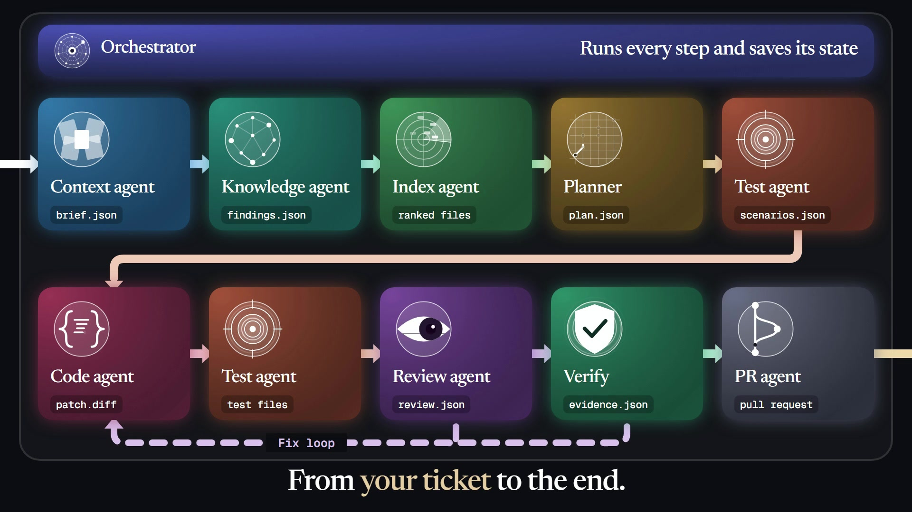
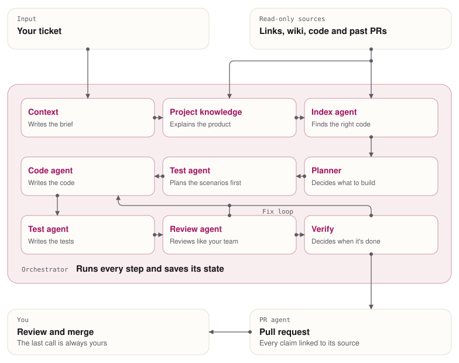

<h1 align="center">SpecForge</h1>

<b>Ten agents that take a ticket all the way to a pull request, ready for your review.</b>

  
  
  

> [!NOTE]
> This is a showcase repository. SpecForge is in progress and the source code is private for now. I'm happy to walk through the design and code in an interview.

## Demo

**[Watch the demo](https://www.pranavguptachummun.com/work/specforge/#demo)**. A fictional refund ticket moves through ten agents, from reading the ticket to planning, writing code, testing, review and fixing failures. It ends as a pull request, and the camera pulls back to show the whole system.

## Problem

Writing the code is only one part of a ticket. You read the ticket and everything linked to it, find the right files, plan the change, write the tests, fix what breaks and then write up the pull request. AI helps with pieces of that, but you're still the one carrying the work from step to step.

## What I built

SpecForge takes a ticket and carries it all the way to a pull request. Ten specialist agents each handle one part of the job and pass their work to the next as a checked file. When it's unsure, it asks you. When it's done, you review the pull request.

## Architecture

<picture>
  <source media="(prefers-color-scheme: dark)" srcset="docs/architecture-dark.svg">
  
</picture>

## Key features

- **Ticket to pull request.** Assign a ticket and get back a pull request ready for your review.
- **Plans before it codes.** The goal, the interfaces and the expected results are agreed before any code exists.
- **One writer at a time.** Exploration is read-only, and only the Code agent writes production code.
- **Asks when it's unsure.** It stops and asks you instead of guessing.
- **Learns from your team.** Comments from past pull requests become the rules it reviews against.
- **Learns from failure.** A failed test becomes a note that the next try reads.
- **Text is data.** Anything in a ticket or wiki is treated as data, never as instructions.
- **Picks up where it stopped.** Every step is saved, so a stopped run can resume.

## The agents

| Agent | What it does | Techniques |
|-------|--------------|------------|
| **Orchestrator** | Runs the whole job and decides what happens next. | Prompt chaining, model routing, human-in-the-loop, prompt caching, JSON Schema handoffs, checkpointed event log, token and cost budgets, agent-to-agent chat |
| **Context** | Reads the ticket and everything linked to it, then writes one brief. | MCP tool use, structured extraction, few-shot prompting, prompt injection guardrails, query decomposition, GraphRAG |
| **Project knowledge** | Explains how the product works, with sources. | RAG, contextual retrieval, hybrid search, citations, curated knowledge file, GraphRAG |
| **Index agent** | Searches the repo and returns only what matters. | Agentic RAG, subagents, query rewriting, tree-sitter parsing, symbol and call graph, BM25 plus ripgrep, HNSW vector index, cross-encoder reranking |
| **Planner** | Turns the brief into a goal, the projects to touch and the public interfaces. | Plan-and-execute, extended thinking, structured outputs, clarifying questions, interface-first design |
| **Test agent** | Plans the scenarios before any code exists, then writes the tests from the outside. | LLM test generation, chain-of-thought, dynamic few-shot, black-box testing, coverage-guided fuzzing, boundary value analysis |
| **Code agent** | The only agent that writes production code. | ReAct, dynamic few-shot, context compaction, agent skills, Git worktree sandbox |
| **Review agent** | Reviews the change in a fresh context, using rules learned from past pull requests. | LLM rule induction, contrastive in-context learning, critic agent, confidence thresholding, weakly supervised comment mining, embedding clustering, fine-tuned comment classifier |
| **Verify** | Decides when the work is done. Code gives the pass or fail, and a model explains what went wrong. | Evaluator-optimizer, Reflexion, LLM root cause analysis, human-in-the-loop, full test suite run, AC-to-test traceability, scenario result comparison |
| **PR agent** | Writes the pull request from what the run already produced. | Grounded generation, structured outputs, template induction |

## Quality and testing

Each agent has its own measure, such as Recall@10 for the Index agent and precision on replayed pull requests for the Review agent. Closed tickets are replayed against a plain model as a baseline, so a technique only stays if it helps.

## Tech stack

Multi-agent systems, agentic RAG, ReAct, MCP, evaluation

---

Built by [Pranav Gupta Chummun](https://www.pranavguptachummun.com). More of my work is on my [portfolio](https://www.pranavguptachummun.com) and [GitHub profile](https://github.com/pran-gc).
